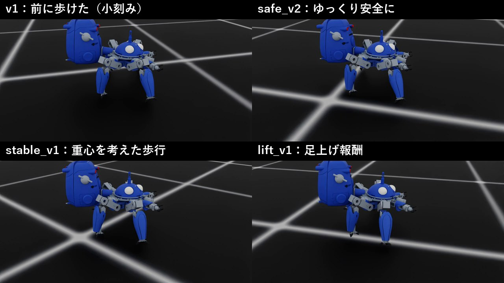
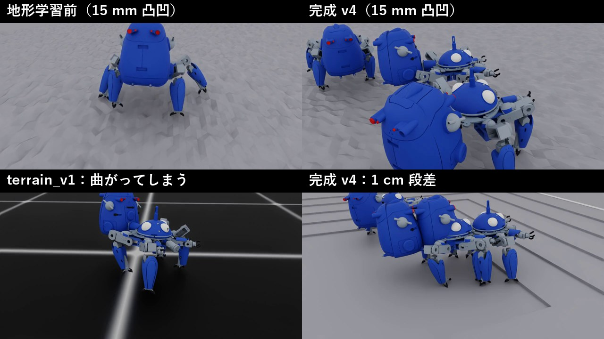

# タチコマを前に歩かせる ― 強化学習による四脚歩行の試行錯誤

Physical AI 応用1 最終課題　レポート

## 1. 課題の概要と目的

『攻殻機動隊』に登場する多脚戦車「タチコマ」の 3D モデル（約 2.9 kg、脚 12 軸は DS3218 サーボ相当）を譲り受け、
シミュレータ上で強化学習により歩行を学習させた。
タチコマは脚の付け根が横を向いた構造のため、**横歩きはすぐに習得** した。一方で、**前に歩くことは難しかった**。
そこで本課題では次の 3 つをタスクとして設定した。

1. **前向きに歩く**（指令した方向へ、体の向きのまま進む）
2. **安全に歩く**（小刻みでなく、転ばず、重心を足の内側に保つ）
3. **いろいろな地形を歩く**（凸凹・段差・坂で転ばない）

目的は、歩けるロボットを作ること自体に加えて、**報酬設計 → 学習 → 評価 → 原因分析 → 修正** の反復を通じて、
強化学習で「思った通りの動き」を引き出す難しさと勘所を身につけることである。

## 2. 使用したツールと AI

| 項目 | 内容 |
|---|---|
| シミュレータ | NVIDIA Isaac Sim ＋ Isaac Lab 3.x（manager-based 環境） |
| AI（学習） | 強化学習 PPO（RSL-RL）。4096 体を GPU 上で並列にシミュレーションして学習 |
| AI（推論） | 学習した方策ネットワーク（MLP 128×128）が、観測 64 次元から 20 関節の目標角度を毎 0.02 秒出力 |
| 方策への入力 | 胴体の速度・姿勢、関節角度・速度、前回の行動、速度指令（地形の高さは見せない＝実機と同じ「盲目」の方策） |
| 計算機 | RTX 5090。1 回の学習（2000〜3000 反復）は約 1.5〜2 時間 |

## 3. 取り組みの流れ

| 段階 | ねらい | 主な変更 | 結果 |
|---|---|---|---|
| 0 | なぜ前に歩けないか | ― | 構造上、横歩きが楽（脚の付け根が横向き）。さらに Isaac Lab は +X 軸を前とみなすが、このモデルの前は +Y 軸で、+X は右だった。指令が速すぎる・トルク制御と内部 PD の綱引き、も重なっていた |
| v1 | 前に歩く | 速度を機体基準に変換、位置制御（実機サーボと同方式）、指令を遅く・報酬の幅を調整 | 0.2 m/s 指令で 10 秒に **2.00 m** 前進、向きのずれ 1.7° |
| safe | 小刻みをやめる | 3 本支持・足すべり・急な動きの罰 | 1 回目は「わざと転んで終わらせる」を学習 → 生存報酬を増やし解決。歩数 4.1 → 1.6 歩/秒 |
| stable | 重心を考える | 順運動学で解析し、立ち姿勢の調整と **安定余裕の報酬** を追加 | 安定余裕 +48 mm、向きのずれ 4.2° |
| lift | 足を上げる | 足先の高さの報酬 | 足を「ゆっくり動かして」罰を避けるすり抜け。地形にはかえって弱くなった |
| terrain v1 | 地形で鍛える | 縮小した地形とカリキュラム学習 | 凸凹での転倒 54 → **0** 体。ただし歩きながら右へ曲がるように |
| terrain v2 | 曲がり・逃げを直す | 向きの報酬の重み 3 倍、降格条件の変更 | 学習中の数字は改善したが、評価コースでは変化なし |
| terrain v3 | 原因に合わせて直す | 向きの報酬の **幅（std）** を 0.5 → 0.15、カリキュラムを「速度追従の出来」で判定 | 前進・直進性・段差が改善したが、曲がる癖は残った |
| terrain v4 | まっすぐ歩く | 半数の個体に「この方角を向け」という指令を与えて学習（heading command）。学習途中のモデルも評価し、最良の 7300 回目を採用 | **向きのずれ 4°、1 cm 段差 72%、転倒 0**（後述） |

## 4. 工夫した点

### 4.1 技術面

- **接地センサの修正**：ロボットの USD はリンクが入れ子になっており、Isaac Lab 標準の処理では胴体にしか接地センサが付かなかった。
  スポーン関数をラップして全リンクに接地 API を付与した（`assets/spawn.py`）。これで「何本の足が着いているか」を報酬に使えるようになった。
- **安定余裕の報酬**：着地している足が作る多角形（支持多角形）と重心の距離を毎ステップ計算し、1 cm を切ったら罰を与えた（`support_margin`）。
  事前に URDF から順運動学で重心位置を計算し、重心が足の中心より約 3.4 cm 後ろにあることを突き止めて、立ち姿勢も調整した。
- **小型機に合わせた地形**：Isaac Lab 標準の地形は大型四脚向け（段差 5〜23 cm）なので、高さ 0.5〜2.5 cm・解像度 2.5 cm に縮小した。
  足を上げられる高さ（約 2.3〜3.4 cm）を順運動学で見積もり、そこから上限を決めた。
- **独自のカリキュラム**：標準の「1.5 m 歩けたら昇格」は秒速 0.1 m の機体では届かないため、自作した。
  最終版（v3）は「エピソード全体でどれだけ速度指令に追従できたか」で昇格・降格を判定する（`terrain_levels_tracking`）。
- **固定条件の評価スクリプト**：指令を固定して 64 体 × 10 秒歩かせ、前進距離・向きのずれ・歩数・滞空時間・安定余裕・足の持ち上げ高さ・段差を上れた割合を測る
  `eval_forward.py` を作り、全モデルを同じ物差しで比較した。動画も同じカメラ・同じ指令で撮影した。

### 4.2 方法面（失敗から原因を見抜く）

学習中に表示される報酬だけを見ると、どの版も「うまくいっている」ように見えた。
実際には、ロボットが報酬の抜け道を見つけていたケースが何度もあった。

| 現象 | 抜け道 | 対策 |
|---|---|---|
| エピソードが 0.2 秒に縮む | 罰が生存報酬より大きく、「すぐ転んで終わらせる」ほうが得 | 生存報酬 +0.5 → +2.0、転倒の罰 −2 → −20 |
| 足上げ報酬で足が上がらない | 足をゆっくり動かすと罰が小さくなる | 平地での報酬工夫をやめ、地形で鍛える方針に転換 |
| 地形レベルが学習後半に下がる | 難所でゆっくり歩くと易しい地形へ降格され、そこでは報酬が高い | 降格条件を「転倒」中心に変更 |
| 重みを 3 倍にしても曲がる癖が直らない | 報酬の幅が広く、毎秒 10° 曲がっても報酬が 9 割残っていた | 重みではなく幅（std）を狭めた |
| 学習の最後に「歩かなくなる」 | 向きの報酬が厳しく、歩いて向きがぶれるより、ほとんど歩かないほうが得 | 途中のモデルを同じ条件で評価し、最良の時点を採用 |

## 5. 結果

評価条件：前進 0.08 m/s の指令、64 体 × 10 秒（「✕」は転倒数）

| コース | stable_v1（地形学習前） | terrain_v1 | terrain_v2 | terrain_v3 | **terrain_v4（完成）** |
|---|---|---|---|---|---|
| 平地：10 秒の前進 | 0.80 m | 0.34 m | 0.34 m | 0.45 m | **0.77 m** |
| 平地：向きのずれ | 4.2° | −94° | −95° | −71° | **−4.4°** |
| 平地：歩数（1 本あたり） | 1.6 歩/秒 | ― | ― | ― | **1.4 歩/秒** |
| 15 mm 凸凹：転倒 | 54/64 | 0/64 | 0/64 | 0/64 | **0/64** |
| 15 mm 凸凹：前進 | ― | 0.16 m | 0.12 m | 0.31 m | **0.45 m** |
| 15 mm 凸凹：向きのずれ | ― | ― | ― | −59° | **−3.7°** |
| 1 cm 段差：1 段以上上れた | 61%（3✕） | 0% | 0% | 22%（0✕） | **72%（0✕）** |
| 2 cm 段差：1 段以上上れた | 2%（12✕） | 0% | 0% | 0%（0✕） | 9%（0✕） |

- 平地では stable_v1 で「前向き・安全・まっすぐ」の歩行を達成した（目的 1・2）。
- 地形学習によって、凸凹で転ばない頑健さを獲得した（目的 3 の一部）。
- その副作用として **歩きながら右へ曲がる癖** が生まれ、v3 でも直りきらなかった。
- v4 では、まず原因を切り分けた。stable_v1 のモデルを地形学習用の環境で歩かせると、ずれは 4° でまっすぐ歩けた。
  したがって、原因は環境ではなく、方策が身につけた癖だった。
  そこで「この方角を向け」という指令を学習に加えたところ、**平地・凸凹・段差のすべてで、向きのずれが 5° 以内** になった。
  1 cm の段差を上れる割合も 72% に上がり、平地では 1 秒に 1.4 歩の、ゆっくり大きな歩幅に戻った。
- v4 を最後（7996 回目）まで学習させると、方策は **ほとんど歩かなくなった**（10 秒で 0.12 m）。
  途中のモデル（5500〜7700 回目）を同じ条件で評価し、全体の釣り合いが最も良い 7300 回目を完成版とした。
- 残る課題：凸凹での前進は 0.45 m（平地の 6 割）にとどまる。2 cm の段差は、上れたのが 9% にとどまる（転倒はしない）。

## 6. 考察と学んだこと

1. **報酬は「重み」だけでなく「形」を見る。** 指数型の報酬 `exp(-誤差²/std²)` は、std が広いと誤差があっても報酬がほとんど減らない。
   重みを 3 倍にしても効かなかった原因はここにあった。
2. **罰が強すぎると、ロボットは「自滅」や「すり抜け」を学ぶ。** 強化学習は設計者の意図ではなく、数式を最大化する。
   罰を追加するときは「それを避ける一番安い方法は何か」を先に考える必要がある。
3. **学習中の数字は、条件を固定した評価で必ず裏を取る。** v2 は学習中の地形レベルが 3.85 まで上がったが、評価コースでは改善していなかった。
   カリキュラムの判定方法に抜け穴があり、数字が実力以上に出ていたためである。
4. **ロボットの構造が学習のしやすさを決める。** 脚の付け根が横向きのタチコマにとって、横歩きは「楽な解」だった。
   前に歩かせるには、機体基準の座標で報酬を正しく定義し、実機に近い制御方式（位置制御）と現実的な速度指令を与える必要があった。
5. **学習は長ければ良いとは限らない。** v4 は学習を続けるほど地形レベルが上がったが、最後は「歩かない」方策に崩れた。
   途中のモデルを同じ物差しで評価して最良の時点を選ぶこと（early stopping）が、完成までの決め手になった。

## 7. 実用性と今後の課題

- 方策は位置制御（実機サーボと同じ方式）で、地形の高さを見ない「盲目」の方策にしてあり、カメラや距離センサのない実機にもそのまま載せられる設計にしている。
- 今後の課題：
  - 学習の終盤で「歩かなくなる」崩れを防ぐ報酬設計（前進の報酬と向きの報酬の釣り合い）
  - 凸凹での前進速度、2 cm 以上の段差（足先の高さの報酬を地形学習と組み合わせて再設計）
  - 実機への移植（サーボの遅れ・摩擦のランダム化による sim-to-real）

## 8. 提出物

| ファイル | 内容 |
|---|---|
| `tachikoma_final.mp4` | 動画（2 分 25 秒、**等倍速**）。各段階の歩行を字幕つきで比較し、最後に完成版（v4）の歩行 |
| `tachikoma_lab_code.zip` | コード一式（環境・報酬・カリキュラム・地形・評価／動画作成スクリプト、最終モデル）。再現手順は `README.md` |
| `report.pdf` | 本レポート |

主なファイル（`tachikoma_lab/source/tachikoma_lab/tachikoma_lab/` 以下）：

- `tasks/manager_based/tachikoma_lab/tachikoma_lab_env_cfg.py`：環境・報酬・指令・終了条件（各段階の設定）
- `tasks/manager_based/tachikoma_lab/mdp/rewards.py`：独自の報酬（安定余裕、足の高さ、足すべりなど）
- `tasks/manager_based/tachikoma_lab/mdp/curriculums.py`：独自のカリキュラム
- `tasks/manager_based/tachikoma_lab/terrains.py`：小型機向けの地形
- `assets/tachikoma.py`、`assets/spawn.py`：ロボットの定義と接地センサの修正
- `scripts/rsl_rl/eval_forward.py`：固定条件の評価と動画撮影
